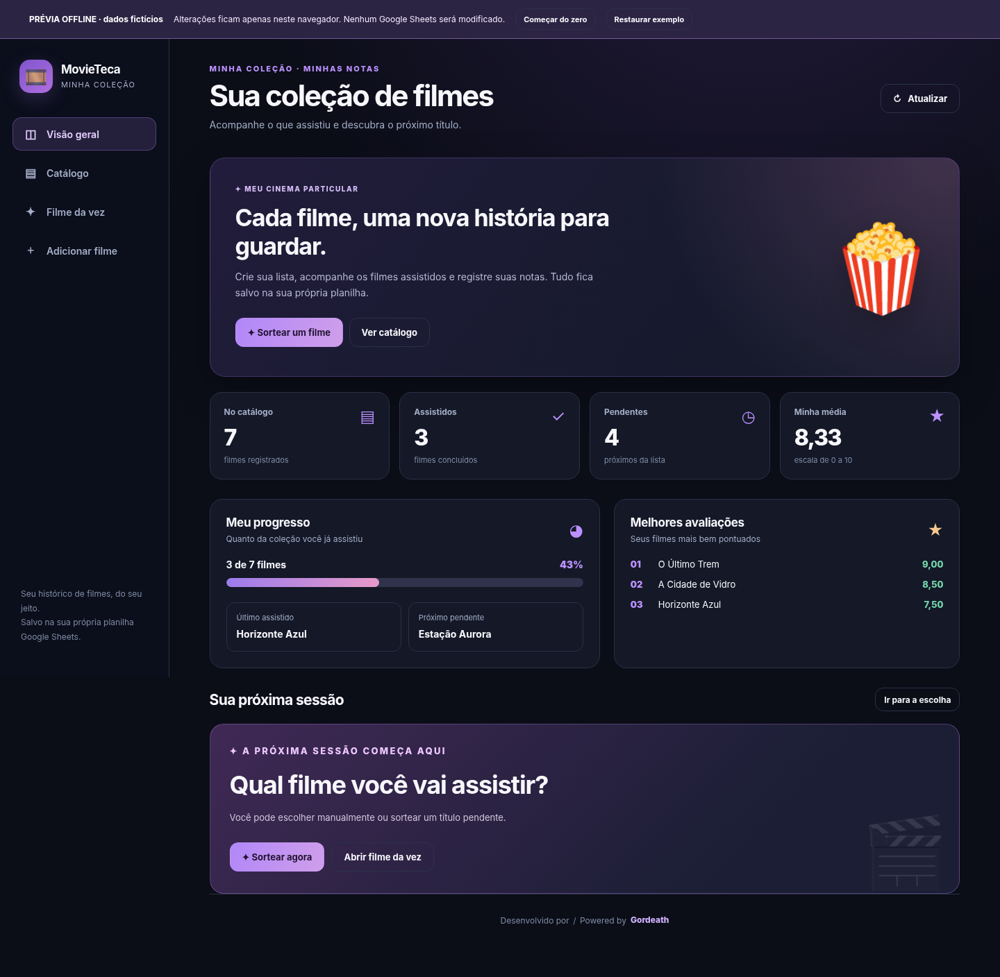
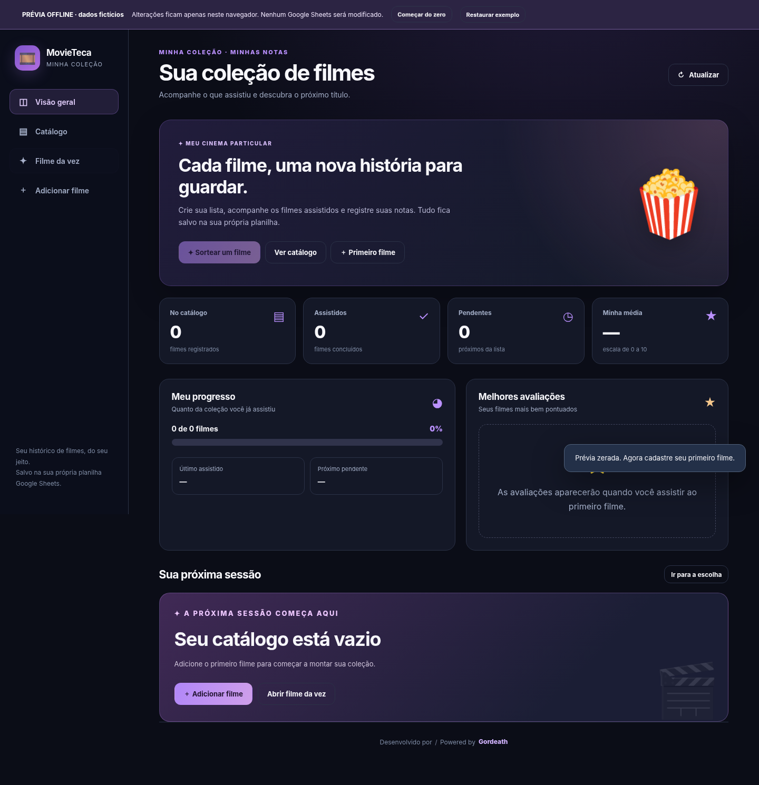
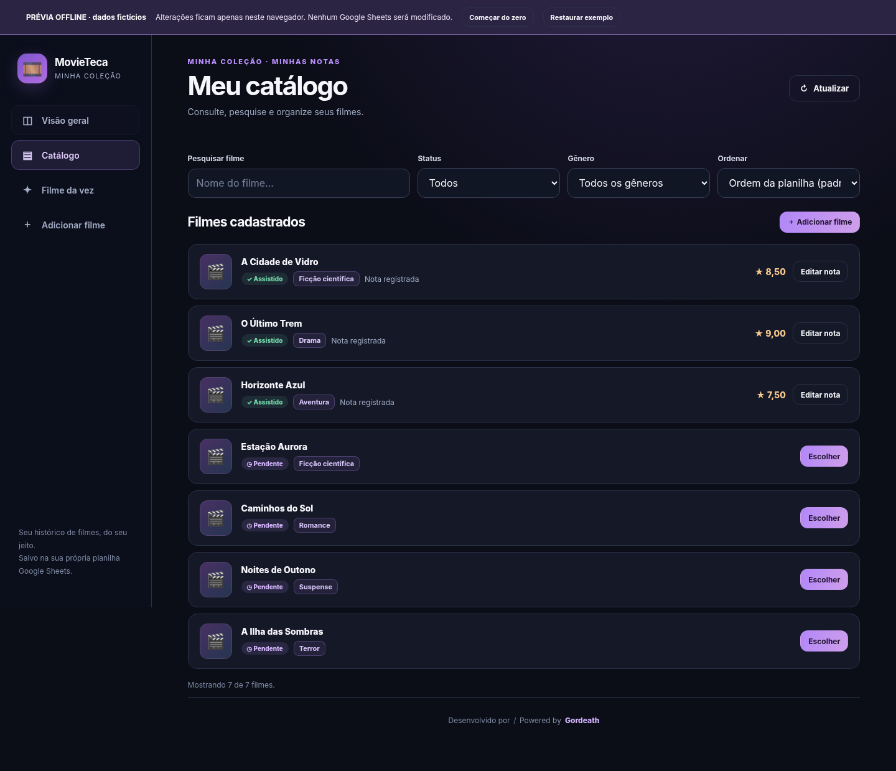
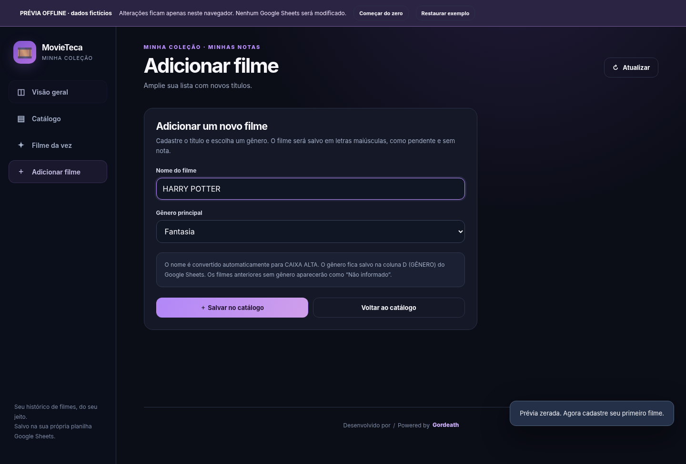

# 🎬 MovieTeca

**Your personal movie catalog, built with Google Sheets + Google Apps Script.**

MovieTeca is a free web app for organizing movies you want to watch, randomly picking what to watch next, and recording your personal ratings. Each user has **their own spreadsheet** and can start from scratch. No external database or paid hosting is required.









## Features

- 📊 **Dashboard:** total movies, watched and unwatched counts, average rating, progress, and top-rated movies.
- 🎬 **Catalog:** movie list with genres, search, filters by **watch status and genre**, and multiple sorting options.
- ➕ **Add movies:** add titles directly to Google Sheets. New movie names are automatically saved in **UPPERCASE** (e.g., `harry PoTTer` → `HARRY POTTER`). A **genre** must be selected, and duplicate titles are prevented.
- 🎲 **Random picker:** randomly selects a movie from the unwatched list.
- ⭐ **Personal ratings:** one rating per movie, from 0 to 10, with up to two decimal places.
- 🕒 **Chronological order:** when you rate an unwatched movie, it moves to the end of the initial watched-movie sequence without changing the relative order of the other titles.
- ✏️ **Edit ratings:** update the rating of a watched movie without changing its position.
- 📱 **Responsive interface:** works on desktop and mobile devices.
- 🆕 **Empty spreadsheet support:** automatically creates the required sheet tab and column headers.
- 💜 **Credits and contact:** bilingual footer displaying **Gordeath**, with a clickable link to compose an email.

## Spreadsheet structure

The app uses a sheet tab named `Filmes` with four columns:

| Column | Header | Contents |
|---|---|---|
| A | `FILMES` | Movie title (new entries are always uppercase) |
| B | `NOTA` | Personal rating from 0 to 10; blank until watched |
| C | `CHECK` | `0` = unwatched; `1` = watched |
| D | `GÊNERO` | Primary genre selected when adding a movie |

The app suggests these 21 genres (displayed in Portuguese): Ação (Action), Animação (Animation), Aventura (Adventure), Biografia (Biography), Comédia (Comedy), Crime, Documentário (Documentary), Drama, Esporte (Sports), Família (Family), Fantasia (Fantasy), Faroeste (Western), Ficção científica (Science Fiction), Guerra (War), História (History), Mistério (Mystery), Musical, Romance, Suspense (Thriller), Terror (Horror), and Outros (Other). You can select one genre per movie.

Uppercase conversion applies **only to newly added movies**; MovieTeca does not automatically change older titles entered directly into the spreadsheet. You do not need to create the columns manually. If the spreadsheet is empty, `setupCatalog()` initializes the structure. Run this function **once in the Apps Script editor** before deploying the app. The system **does not count row 1** (the header row) as a movie.

## Updating an existing installation

1. Back up your spreadsheet.
2. Replace **`Code.gs`** and **`Index.html`** in your Apps Script project.
3. Run `setupCatalog()` in the editor. If column **D** is available, it will receive the `GÊNERO` header. Existing rows will be preserved.
4. Optionally fill in genres for previously added movies directly in `D2:D`.
5. Deploy a **new version** of your web app.

## Quick setup (no terminal required)

1. Go to [Google Sheets](https://sheets.google.com) and create a **blank spreadsheet**. You can name it `My Movie Collection`.
2. Open the spreadsheet and select **Extensions → Apps Script**.
3. In the Apps Script editor, replace the contents of `Code.gs` (or its localized equivalent) with the code from this repository's [`Code.gs`](Code.gs).
4. Click the **+** button next to Files, select **HTML**, name it `Index`, and paste the contents of [`Index.html`](Index.html). The editor will create `Index.html` automatically.
5. Click **Save**.
6. From the Apps Script function selector, choose `setupCatalog()` and click **Run**. Authorize access to your spreadsheet using your Google account. This automatically stores your spreadsheet ID in **Script Properties** (not in the source code) and creates the `Filmes` tab and headers if needed.
7. Select **Deploy → New deployment → Web app**. Under **Execute as**, choose **Me**. Under **Who has access**, prefer **Only myself** for personal use. Click **Deploy**.
8. Open the **web app URL** provided by Google. You can now add your first movie!

> **No hardcoded ID required:** when you create an Apps Script project through **Extensions → Apps Script** inside a spreadsheet, the project is already bound to that file. The `setupCatalog()` function identifies the spreadsheet while running in the editor and saves the reference in private script properties for the web app. `SPREADSHEET_ID` is empty by default and does not need to be configured.

### Using a standalone Apps Script project

In this case, enter the ID of **your own** spreadsheet in `CONFIG.SPREADSHEET_ID` inside `Code.gs`, then run `setupCatalog()` in the editor before deploying. The ID is found in the URL `https://docs.google.com/spreadsheets/d/YOUR_ID_HERE/edit`. **Do not commit this ID to a public repository.**

### If you already have a movie spreadsheet

Make a backup before migrating. Create or use a tab named `Filmes`, and arrange columns A:D with **exactly** `FILMES | NOTA | CHECK | GÊNERO` in row 1; movie entries should begin on row 2. If you have an older version using only columns A:C, `setupCatalog()` adds the `GÊNERO` header to column D **without modifying existing movie entries**. Existing genres will be blank and shown as “Não informado” (Not specified) in the catalog; you can fill them in directly in column D. If column D already contains different data, the system blocks the migration to avoid overwriting it. The app does not delete incompatible headers or overwrite data in another tab. If you create a new Apps Script project, run `setupCatalog()` again; the spreadsheet reference is stored in that project's properties.

## How chronological ordering works

A movie can initially be anywhere in the list. When you rate it, MovieTeca places it immediately before the first movie with `CHECK = 0`, taking the initial contiguous sequence of watched movies into account.

**Before:**

```text
FILMES              NOTA    CHECK    GÊNERO
Movie A             8       1        Drama
Movie B                     0        Aventura
Movie C                     0        Comédia
Movie D                     0        Terror
```

**After rating Movie D with a score of 9:**

```text
FILMES              NOTA    CHECK    GÊNERO
Movie A             8       1        Drama
Movie D             9       1        Terror
Movie B                     0        Aventura
Movie C                     0        Comédia
```

The genre moves together with the movie, so it never becomes incorrectly associated with another row.

By default, the app always displays movies in **spreadsheet row order**. You can select alphabetical sorting in the interface without changing the saved order. If an isolated `CHECK = 1` appears below unwatched movies, it is not treated as the end of the initial chronological block.

## Developer credits and contact

Every screen displays **Desenvolvido por / Powered by Gordeath** in the footer. Click **Gordeath** to open an email draft in your default email application, with a prefilled subject and message in **Portuguese and English**:

- **Subject:** `Desenvolvimento do App/Site de filmes / Movie List App/Website Development`
- **Portuguese message:** `Oi, gostaria de falar com você sobre seu app/site de lista de filmes.`
- **English message:** `Hi, I would like to talk to you about your movie list app/website.`

> **Developer contact setup:** before publishing your copy, edit the line `const GORDEATH_EMAIL = '';` in `Index.html` and insert the correct email address for **Gordeath** between the quotes. No personal email address is included in the repository. The offline preview can be regenerated with `python tools/gerar_previa.py`. If this constant is empty, the link prepares the message **without a recipient**. The `mailto:` link **does not send an email automatically** and requires a configured email client on the device.

The footer credits the project author (Gordeath); it does not use the email address or other personal information of whoever installs the app.

## Offline preview

Open [`PREVIA_Offline.html`](PREVIA_Offline.html) in your browser. It works **without Google Apps Script** and contains only fictional sample data. The **Começar do zero** (Start from scratch) button lets you try a completely empty collection; **Restaurar exemplo** (Restore sample) brings back the demo movies. When available, the browser's local storage retains changes made in the preview. After editing `Index.html`, you can regenerate the demo file with `python tools/gerar_previa.py`.

**Important:** the preview is not the deployed application. It never writes data to a Google spreadsheet.

## Repository files

```text
MovieTeca/
├── Code.gs                    # Backend (Google Apps Script)
├── Index.html                 # Web interface to paste into Apps Script
├── PREVIA_Offline.html        # Offline demo, no Google connection
├── modelo_planilha.csv        # Optional: spreadsheet headers only
├── appsscript.json            # Optional manifest for clasp
├── docs/
│   ├── dashboard.png          # Main dashboard
│   ├── celular.png            # Mobile view
│   └── iniciar-do-zero.png    # Empty collection state
├── tests/
│   ├── backend.test.js        # Node.js backend tests
│   └── browser.test.py        # Optional Playwright UI tests
├── tools/gerar_previa.py      # Regenerates preview after editing Index.html
├── .gitignore
├── LICENSE
└── README.md
```

## Publishing this code on GitHub

You can create a **public** repository and upload the files in this folder without any mandatory changes. In your browser: GitHub → **New repository** → name it `movieteca` → choose **Public** → **Create repository** → **uploading an existing file** → upload the files.

Or use the terminal from inside the project folder:

```bash
git init
git add .
git commit -m "feat: release MovieTeca for individual use"
git branch -M main
git remote add origin https://github.com/YOUR_USERNAME/movieteca.git
git push -u origin main
```

Replace `YOUR_USERNAME` with your GitHub username, and create the empty repository first.

## Tests

**Backend:** only Node.js is required; no additional dependencies:

```bash
node tests/backend.test.js
```

**Interface (optional):** Python, Playwright, and Chromium:

```bash
python tests/browser.test.py
```

## Privacy and security

- This repository **does not include** personal spreadsheets, real ratings, author information, tokens, or spreadsheet IDs.
- Each user should **create their own spreadsheet and deploy their own copy**.
- **Do not share indiscriminately** the URL of an app configured with **Execute as: Me**: anyone who has access to the app may be able to modify your catalog using the owner's permissions. For personal use, limit access to **Only myself**.
- Publishing the **code on GitHub** does not make your spreadsheet public.
- The app does not query external movie services or make requests to commercial APIs.

## License

[MIT](LICENSE). Contributions and improvements are welcome.
