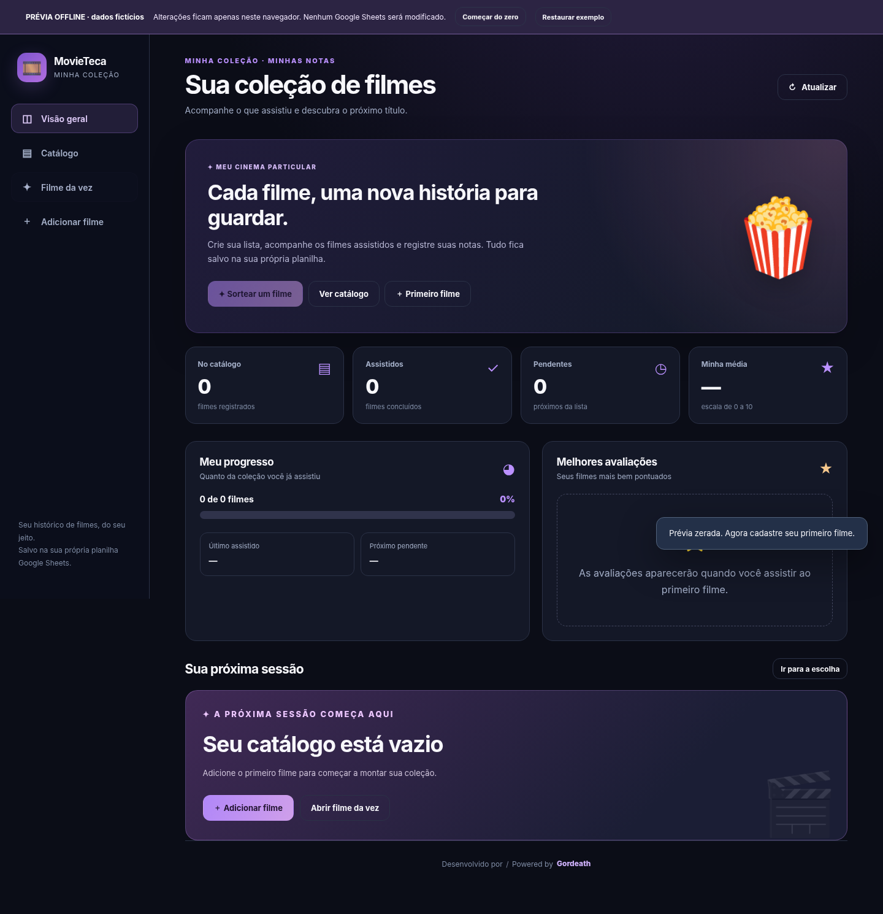
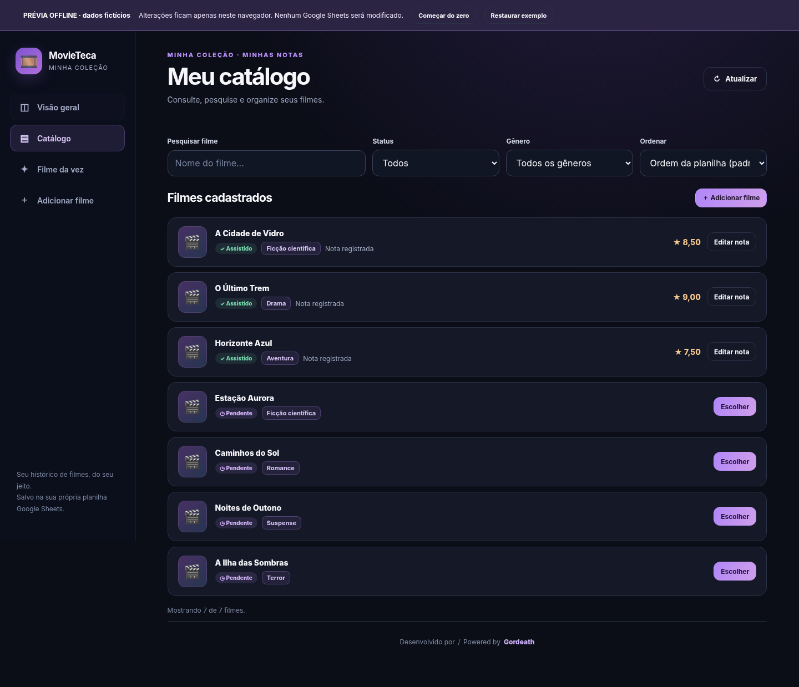
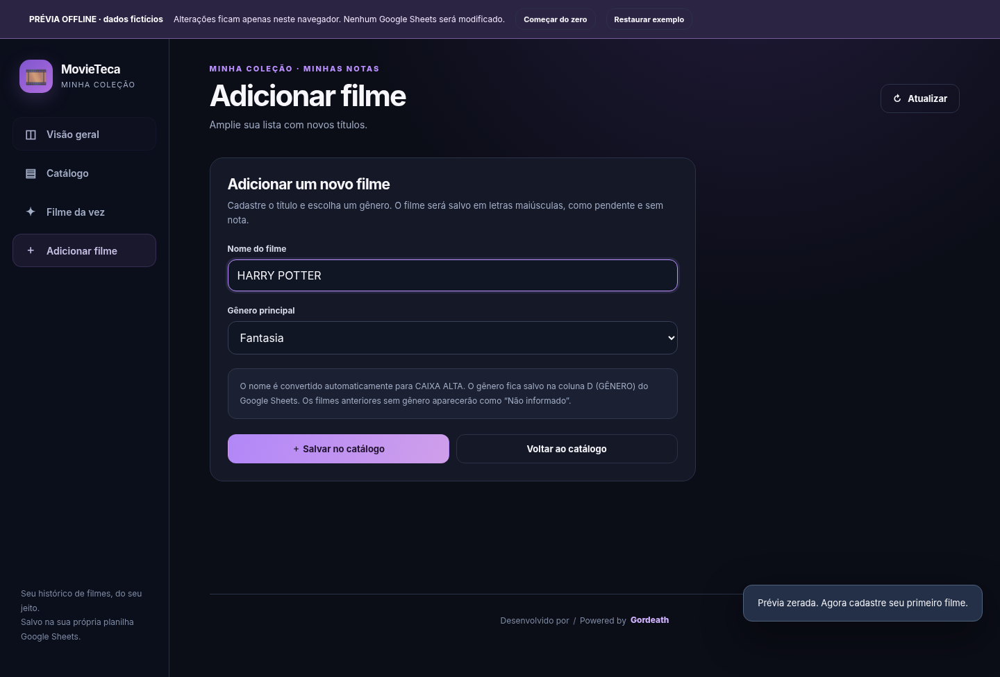

# 🎬 MovieTeca

**Seu catálogo de filmes pessoal, feito com Google Sheets + Google Apps Script.**

O MovieTeca é um aplicativo web gratuito para organizar filmes que você pretende assistir, sortear o próximo título e registrar suas avaliações individuais. Cada pessoa usa **a própria planilha**, começando do zero se quiser. Não há banco de dados externo nem necessidade de hospedagem paga.








## Funcionalidades

- 📊 **Dashboard**: total, assistidos, pendentes, média das avaliações, progresso e filmes mais bem avaliados.
- 🎬 **Catálogo**: lista de filmes com o gênero, busca, filtros por status **e gênero**, e diferentes ordenações.
- ➕ **Cadastro**: adiciona filmes diretamente ao Google Sheets, salvando automaticamente os novos títulos em **CAIXA ALTA** (ex.: `harry PoTTer` → `HARRY POTTER`), com seleção obrigatória de **gênero**, sem duplicatas.
- 🎲 **Sorteador**: escolhe aleatoriamente entre os filmes pendentes.
- ⭐ **Avaliação individual**: uma única nota por filme (de 0 a 10, com até duas casas decimais).
- 🕒 **Ordem cronológica**: ao avaliar um filme pendente, ele é movido para depois da sequência de assistidos, sem alterar a ordem relativa dos outros títulos.
- ✏️ **Edição de notas**: modifica a avaliação de um filme assistido sem mudar sua posição.
- 📱 **Interface responsiva** para computador e celular.
- 🆕 **Planilha vazia**: cria automaticamente a aba e os cabeçalhos necessários.
- 💜 **Créditos e contato**: rodapé bilíngue com o nome **Gordeath**, clicável para redigir um e-mail.

## Estrutura da planilha

O aplicativo usa a aba `Filmes`, com quatro colunas:

| Coluna | Cabeçalho | Conteúdo |
|---|---|---|
| A | `FILMES` | Nome do filme (novos cadastros sempre em maiúsculas) |
| B | `NOTA` | Nota individual de 0 a 10; vazia até assistir |
| C | `CHECK` | `0` = pendente; `1` = assistido |
| D | `GÊNERO` | Gênero principal escolhido no cadastro |

Os gêneros sugeridos são: Ação, Animação, Aventura, Biografia, Comédia, Crime, Documentário, Drama, Esporte, Família, Fantasia, Faroeste, Ficção científica, Guerra, História, Mistério, Musical, Romance, Suspense, Terror, Outros. É possível selecionar um gênero por filme.

A conversão em maiúsculas é aplicada **somente aos novos cadastros**; o MovieTeca não altera automaticamente títulos antigos digitados diretamente na planilha. Não é preciso criar essas colunas manualmente. Se a planilha estiver vazia, `setupCatalog()` inicializa a estrutura. Essa função deve ser executada **uma vez no editor** antes da publicação. O sistema **não conta a linha 1** como filme.

## Atualização de uma instalação existente

1. Faça backup da sua planilha.
2. Substitua **Code.gs** e **Index.html** no projeto Apps Script.
3. Execute `setupCatalog()` no editor: a coluna **D** passará a ter o cabeçalho `GÊNERO` se estiver livre. As linhas antigas serão preservadas.
4. Se quiser, preencha os gêneros dos filmes anteriores diretamente em `D2:D`.
5. Publique uma **nova versão da implantação**.

## Instalação rápida (sem terminal)

1. No [Google Sheets](https://sheets.google.com), crie uma **planilha em branco**. Pode chamá-la de `Minha coleção de filmes`.
2. Abra a planilha e acesse **Extensões → Apps Script**.
3. No editor do Apps Script, substitua o conteúdo de `Código.gs` (ou `Code.gs`) pelo código deste repositório em [`Code.gs`](Code.gs).
4. Clique no botão **+** próximo de Arquivos, escolha **HTML**, dê o nome `Index` e cole o conteúdo de [`Index.html`](Index.html). O editor criará `Index.html` automaticamente.
5. Clique em **Salvar**.
6. No seletor de funções do Apps Script, escolha `setupCatalog()` e clique em **Executar**. Autorize o acesso à planilha na sua conta Google. Isso registrará automaticamente o ID da sua planilha nas **Propriedades do Script** (não no código) e criará a aba `Filmes` com os cabeçalhos, se necessário.
7. Clique em **Implantar → Nova implantação → Aplicativo da Web**. Em **Executar como**, escolha **Eu**. Em **Quem tem acesso**, prefira **Somente eu** para uso pessoal. Clique em **Implantar**.
8. Abra a **URL do aplicativo da Web** gerada pelo Google. Você já pode adicionar o primeiro filme!

> **Sem ID fixo:** ao criar o Apps Script por **Extensões → Apps Script** dentro da própria planilha, o projeto já fica vinculado ao arquivo. A função `setupCatalog()` identifica a planilha no editor e guarda a referência em propriedades privadas para o aplicativo web. Por padrão, `SPREADSHEET_ID` está vazio e não precisa ser configurado.

### Se usar um projeto Apps Script independente

Nesse caso, informe o ID da *sua* planilha em `CONFIG.SPREADSHEET_ID` no `Code.gs` e execute `setupCatalog()` no editor antes de implantar. O ID está na URL `https://docs.google.com/spreadsheets/d/SEU_ID_AQUI/edit`. **Não coloque esse ID no repositório público**.

### Se você já tem uma planilha com filmes

Faça uma cópia de segurança antes de migrar. Crie ou use a aba `Filmes` e organize as colunas A:D com **exatamente** `FILMES | NOTA | CHECK | GÊNERO` na linha 1; deixe os filmes a partir da linha 2. Se você já tem a versão anterior com apenas A:C, `setupCatalog()` acrescenta o cabeçalho `GÊNERO` na coluna D **sem mexer nos filmes antigos**. Os gêneros antigos ficam em branco e aparecem como “Não informado” no catálogo; você pode preenchê-los diretamente na coluna D. Se D já tiver dados diferentes, o sistema bloqueia a migração para não sobrescrevê-los. A aplicação não apaga cabeçalhos incompatíveis nem sobrescreve dados de outra aba. Se criar um novo projeto Apps Script, execute novamente `setupCatalog()`; a identificação da planilha fica nas propriedades desse projeto.

## Como funciona a ordem cronológica

Ao começar, o filme pode estar no meio ou no final da lista. Quando você o avalia, o MovieTeca o coloca imediatamente antes do primeiro filme com `CHECK = 0`, considerando a sequência inicial de assistidos.

**Antes:**

```text
FILMES              NOTA    CHECK    GÊNERO
Filme A             8       1        Drama
Filme B                     0        Aventura
Filme C                     0        Comédia
Filme D                     0        Terror
```

**Depois de avaliar Filme D com nota 9:**

```text
FILMES              NOTA    CHECK    GÊNERO
Filme A             8       1        Drama
Filme D             9       1        Terror
Filme B                     0        Aventura
Filme C                     0        Comédia
```

O gênero acompanha o filme durante a movimentação; ele não fica associado incorretamente a outra linha.

A ordem padrão no aplicativo é sempre **a ordem das linhas da planilha**. Você pode optar pela ordenação alfabética na interface, sem alterar a ordem salva. Se houver um `CHECK = 1` isolado abaixo de pendentes, ele não é usado como fim do bloco cronológico inicial.

## Créditos e contato do desenvolvedor

Todas as telas exibem no rodapé **Desenvolvido por / Powered by Gordeath**. Clique em **Gordeath** para abrir um rascunho de e-mail no programa padrão, com assunto e corpo preenchidos em **português e inglês**:

- **Assunto / Subject:** `Desenvolvimento do App/Site de filmes / Movie List App/Website Development`
- **Mensagem em português:** `Oi, gostaria de falar com você sobre seu app/site de lista de filmes.`
- **English message:** `Hi, I would like to talk to you about your movie list app/website.`

> **Configuração do contato do autor:** antes de publicar sua cópia, edite em `Index.html` a linha `const GORDEATH_EMAIL = '';`, colocando o endereço correto do **Gordeath** entre aspas. Nenhum endereço pessoal está incluído no repositório. A prévia offline pode ser regenerada com `python tools/gerar_previa.py`. Com a constante vazia, o clique prepara a mensagem **sem destinatário**. A função `mailto:` **não envia e-mails automaticamente** e depende de um cliente de e-mail configurado no dispositivo.

O rodapé refere-se ao autor do projeto (Gordeath); ele não usa o e-mail ou outros dados da pessoa que instalar o aplicativo.

## Prévia offline

Abra [`PREVIA_Offline.html`](PREVIA_Offline.html) no navegador. Ela funciona **sem Google Apps Script** e contém somente dados fictícios. O botão **Começar do zero** permite experimentar uma coleção totalmente vazia; **Restaurar exemplo** recupera os títulos demonstrativos. Quando disponível, o armazenamento local do navegador retém as alterações da prévia. Depois de editar `Index.html`, você pode regenerar o arquivo de demonstração com `python tools/gerar_previa.py`.

**Importante:** a prévia não é a aplicação publicada. Ela nunca grava dados em uma planilha Google.

## Arquivos do repositório

```text
MovieTeca/
├── Code.gs                    # Backend (Google Apps Script)
├── Index.html                 # Interface web a ser colada no Apps Script
├── PREVIA_Offline.html        # Demonstração sem conexão ao Google
├── modelo_planilha.csv        # Opcional: apenas o cabeçalho da planilha
├── appsscript.json            # Manifesto opcional para uso com clasp
├── docs/
│   ├── dashboard.png          # Tela principal
│   ├── celular.png            # Visualização mobile
│   └── iniciar-do-zero.png    # Estado vazio da coleção
├── tests/
│   ├── backend.test.js        # Testes do backend com Node.js
│   └── browser.test.py        # Testes opcionais da interface com Playwright
├── tools/gerar_previa.py      # Regenera a prévia após alterar Index.html
├── .gitignore
├── LICENSE
└── README.md
```

## Publicar este código no seu GitHub

Você pode criar um repositório **público** e enviar os arquivos desta pasta, sem nenhuma alteração obrigatória. No navegador: GitHub → **New repository** → nome `movieteca` → **Public** → **Create repository** → **uploading an existing file** → envie os arquivos.

Ou pelo terminal, dentro desta pasta:

```bash
git init
git add .
git commit -m "feat: disponibiliza MovieTeca para uso individual"
git branch -M main
git remote add origin https://github.com/SEU_USUARIO/movieteca.git
git push -u origin main
```

Substitua `SEU_USUARIO` pelo seu usuário e crie antes o repositório vazio no GitHub.

## Testes

Backend: basta ter Node.js instalado, sem dependências adicionais:

```bash
node tests/backend.test.js
```

Interface (opcional): Python, Playwright e Chromium:

```bash
python tests/browser.test.py
```

## Privacidade e segurança

- Este repositório **não inclui** planilhas pessoais, avaliações reais, dados do autor, tokens nem IDs de planilhas.
- Cada usuário deve **criar sua própria planilha e fazer sua própria implantação**.
- **Não compartilhe indiscriminadamente** a URL de um aplicativo configurado para **Executar como: Eu**: quem tiver acesso ao aplicativo poderá alterar o catálogo com as permissões do proprietário. Para uso individual, limite o acesso a **Somente eu**.
- Publicar o **código no GitHub** não torna sua planilha pública.
- A aplicação não consulta serviços de filmes externos e não faz requisições a APIs comerciais.

## Licença

[MIT](LICENSE). Contribuições e melhorias são bem-vindas.
